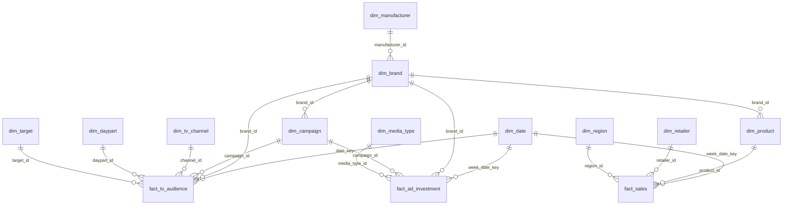

# Cereal Category Data Warehouse

A star-schema data warehouse for the breakfast cereal category, with **dummy data** for 5 fictional brands covering 2024–2025:

- **TV audiences** – every aired spot with channel, daypart, target, GRPs, impressions and cost
- **Advertising investment** – weekly spend by brand, campaign and media type (TV, digital video, social, OOH, radio)
- **Sales** – weekly retail sales by product, retailer and region, with price, promotions and distribution

The data is fake but internally consistent: TV investment equals the sum of spot costs, and sales respond to TV pressure (adstock with diminishing returns), seasonality, promotions and price — so analyses return realistic patterns.

## Brands

| Brand | Manufacturer | Segment | Price tier | Main TV target |
|---|---|---|---|---|
| ChocoPlanet | Granja Foods | Kids | Mainstream | Kids 4-12 |
| Crispy Valley | Nordic Cereals Co. | Family | Mainstream | Shoppers 25-54 |
| FiberFit | Mediterránea de Alimentación | Health | Premium | Adults 25-54 |
| Golden Honey Rings | Granja Foods | Kids | Value | Kids 4-12 |
| Muesli Alpino | Nordic Cereals Co. | Adult | Premium | Adults 35-64 |

## Data model



| Fact table | Grain | Rows |
|---|---|---|
| `fact_tv_audience` | one aired spot | ~28,000 |
| `fact_ad_investment` | brand × campaign × media type × week | ~1,100 |
| `fact_sales` | product × retailer × region × week | ~53,600 |

`dim_brand` and `dim_date` are **conformed dimensions** shared by all three facts — that is what lets you compare audiences, investment and sales side by side. Daily TV data rolls up to the weekly grain through `dim_date.week_start`.

## Project structure

```
cereal_dwh/
├── sql/
│   ├── 01_schema.sql            # DDL (PostgreSQL & DuckDB compatible)
│   ├── 02_analysis_queries.sql  # 6 business questions answered in SQL
│   └── 03_load_postgres.sql     # \copy commands to load the CSVs
├── scripts/
│   └── generate_data.py         # builds the dummy data (seeded, reproducible)
└── data/
    ├── *.csv                    # one file per table
    └── cereal_dwh.duckdb        # ready-to-query database
```

## How to use it

**Option A – DuckDB (no setup):** open `data/cereal_dwh.duckdb` in DBeaver or the DuckDB CLI and run the queries in `sql/02_analysis_queries.sql`.

**Option B – PostgreSQL:**
```bash
createdb cereal_dwh
psql -d cereal_dwh -f sql/01_schema.sql
psql -d cereal_dwh -f sql/03_load_postgres.sql
```

**Regenerate the data** (change the seed, dates or brand parameters at the top of the script):
```bash
pip install duckdb pandas numpy
python scripts/generate_data.py
```

## Business questions answered (`02_analysis_queries.sql`)

1. Market share by brand and year (value and volume)
2. Share of Voice vs Share of Market
3. Media mix by brand
4. TV efficiency: cost per GRP and CPM by channel
5. Best dayparts for kids brands
6. Weekly TV pressure vs sales (dataset for charts or modelling)

## Ideas to extend it

- Build a Power BI / Tableau dashboard on top of the star schema
- Fit a marketing mix model (adstock + saturation) in Python on the Q6 output
- Add a competitor-pricing fact or a digital-analytics fact (site visits, searches)

*All brands, manufacturers, retailers and figures are fictional.*
